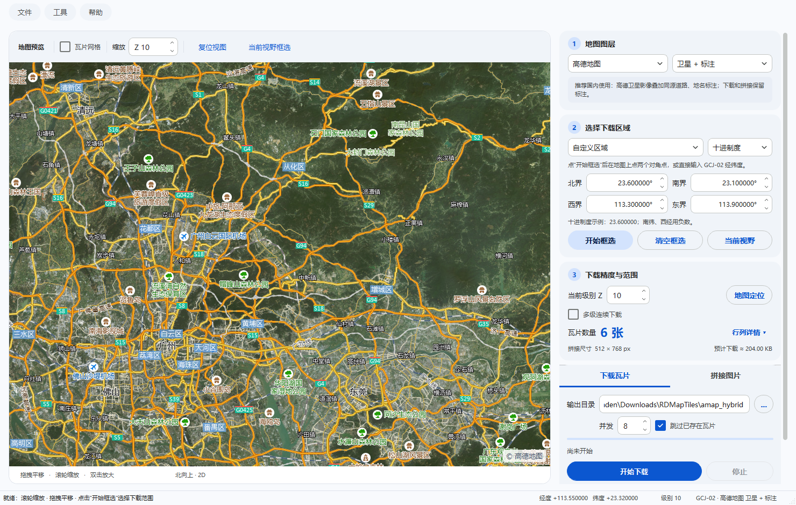
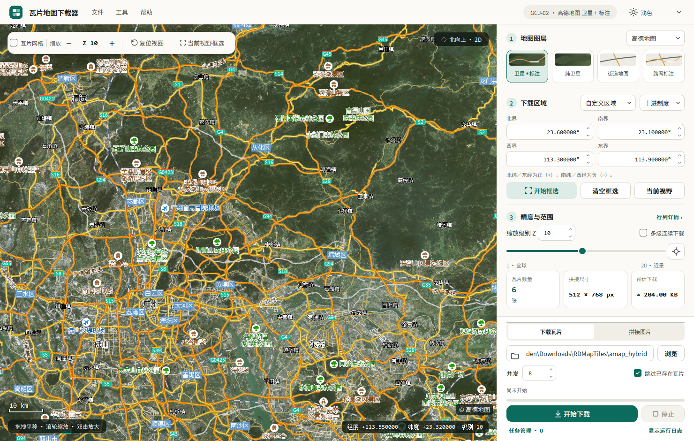
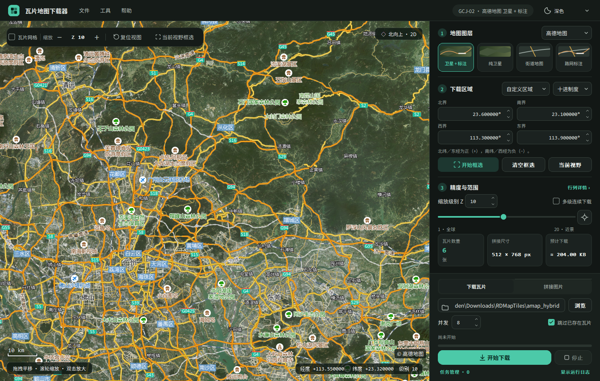
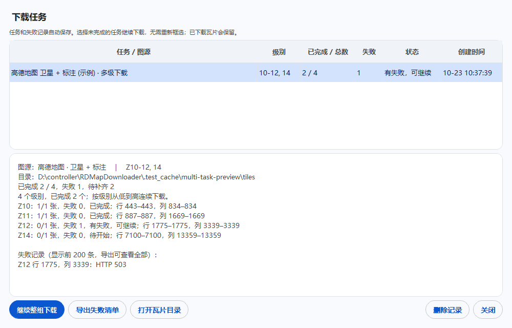
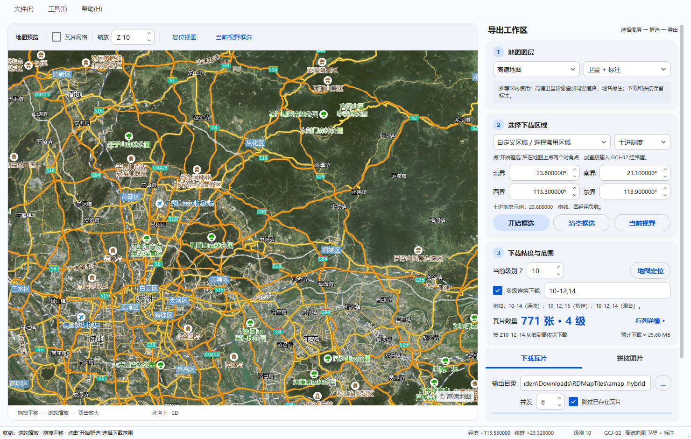

# RDMapDownloader

基于 **Python 3 + PyQt5** 重写的多图源地图瓦片下载与拼接工具，功能对应原 C# / WinForms / GMap.NET 项目
[GMapDownloader](https://github.com/hejustbrave/GMapDownloader)。支持 **高德、Google、天地图、Esri** 四组图源。

原程序依赖 GMap.NET 控件；本版本的 2D 使用 QPainter 自绘瓦片地图，依赖 **PyQt5** 和 **requests**。
可选的 3D 使用 **Qt WebEngine + CesiumJS**，不需要 Unity、GDAL 或 .NET 环境。

项目地址：[XinhaoLiu94/RDMapDownloader](https://github.com/XinhaoLiu94/RDMapDownloader)。
本项目的 Python 实现采用 [GPL-3.0-only](LICENSE)，来源、第三方组件与地图数据的权利说明见 [NOTICE.md](NOTICE.md)。



## 功能

- **2D / 3D 切换**：2D 保留各图源的原生坐标，3D 使用 WGS84 卫星影像与真实高程；分别保存图源、视图和相机。
  同一选区切换时转换坐标，保留原始边界，避免反复切换导致范围扩大；现有下载任务参数独立保存。
- **双主题工作区**：暖白／炭黑底色配绿色强调色，顶部导航、悬浮地图工具、图层缩略卡与分区面板；
  下载／拼接操作固定在右侧底部，滚动设置时仍可直接开始或停止任务。
- **外观切换**：顶部可选择浅色、深色或自动跟随系统，即时生效并记住选择；菜单、任务管理、弹窗和图标同步调整。
  保留 Alt+F / Alt+T / Alt+H 菜单快捷键。
- **卫星 + 标注**：高德、天地图与 Esri 支持影像和透明注记合成，预览、下载、拼接均保留标注；新安装默认选择高德卫星标注。
- **四组图源**：高德（GCJ-02）、Google（坐标基准随图层/地区变化）、天地图（CGCS2000）、Esri（WGS-84）。
  天地图需要填写个人 Key；地图浏览和下载共用当前图层。
- **图源隔离**：瓦片缓存按图源分开；使用默认输出目录时，也会自动按图源类型建立子目录，避免互相覆盖。
- **地图交互**：拖拽平移、滚轮以光标为中心缩放、双击放大、瓦片网格、十字辅助线、比例注记。
- **框选范围**：点击两个对角点生成矩形，实时预览；也可直接输入经纬度，或一键使用当前视野。
- **坐标输入**：支持十进制度和度分秒切换，保留实际范围；输入框下仅保留正负号说明，北纬／东经为正，南纬／西经为负。
- **常用区域**：中国大陆、美国本土、加拿大、英国、法国、德国、日本、韩国、澳大利亚、新西兰、巴西等预设，
  一键填入四至并自动定位地图，可继续微调。每次启动默认选择“自定义区域”，保留上次填写的经纬度。
- **瓦片范围**：由经纬度、级别自动计算行列范围与数量，支持手动微调；超出级别范围会给出提示。
- **下载量预估**：在“预计下载”卡片显示预计下载流量（KB / MB / GB），随范围、级别、图层自动更新，多级下载合计计算；
  悬停可查看每级明细。按常见压缩瓦片大小粗估，无需额外联网，未扣除已有瓦片；标注图层的请求量已计入，合成 PNG 的磁盘占用可能更大。
- **并发下载**：
  - 默认 8 并发，可调 1–32；
  - 请求超时、自动重试、随机浏览器 UA；
  - 跳过已存在瓦片、原子写入避免半截文件；
  - 实时显示百分比、速度、失败数和剩余时间；
  - 可随时停止，失败明细写入日志。
- **图片拼接**：按 `输出目录/级别/行/列.png` 规则拼接，支持 PNG、JPG、WebP、BMP、TIFF；
  自动统计缺失瓦片，带内存/尺寸安全上限。
- **工程化细节**：磁盘+内存瓦片缓存、配置自动保存、可折叠运行日志、任务进行中关闭确认。
  日志记录图源／图层切换、框选结果、下载、拼接及错误信息，不记录缩放、平移等基础操作说明。
- **下载任务管理**：每次下载自动保存为任务，持久化图源、范围、输出目录和全部失败瓦片；
  停止或重启后可继续原任务，跳过已成功瓦片，补下载失败、损坏或尚未完成的瓦片，支持导出失败清单。
- **多级连续下载**：支持 `10-14, 16, 18` 这样的连续范围和离散级别，自动排序、去重；
  同一区域按级别从低到高依次下载，在任务管理中合并为一组，并保留每一级的进度和失败记录。

## 环境要求

- Windows 10 / 11（其他桌面系统理论可用，未重点测试）
- Python 3.10+（已在 Python 3.12 + PyQt5 5.15.11 下测试）
- 依赖见 [requirements.txt](requirements.txt)：`PyQt5`、`requests`

## 快速开始

```powershell
git clone https://github.com/XinhaoLiu94/RDMapDownloader.git
cd RDMapDownloader
python -m pip install -r requirements.txt
python main.py
```

也可以直接双击 [run.bat](run.bat)，脚本会在缺少依赖时自动安装。

需要三维地形时，先安装可选依赖：

```powershell
python -m pip install -r requirements-3d.txt
```

### 三维地图

顶部 **2D / 3D** 切换渲染模式。2D 默认高德 GCJ-02；3D 默认 Esri 卫星加标注，
也可选择 Esri 纯影像或 Google 纯卫星。Google 的大陆道路混合注记不参与 3D，避免叠加偏移。
在三维视图左键拖动、滚轮缩放、中键拖动旋转，点击“倾斜视角”查看地形起伏。
右侧仍可框选、输入经纬度、使用当前视野或常用区域，并通过原有任务管理下载和拼接影像。
两种模式分别记住图源和视图；选区有改动时，另一模式使用转换后的范围。

首次进入 3D 需要联网下载 Cesium 组件，运行资源按需缓存。为兼容 Qt 5 WebEngine 的 Chromium，
当前固定为已验证的 CesiumJS 1.117，主脚本校验 SHA-256，不依赖 Cesium ion 账号或 token。
本机服务仅监听 `127.0.0.1`，使用随机端口和随机路径；退出时关闭。

高程使用 [Mapzen Skadi HGT](https://github.com/tilezen/joerd/blob/master/docs/formats.md)，
其水平基准是 WGS84，垂直基准是 EGM96。加载
[EGM96 格网](https://download.osgeo.org/proj/vdatum/egm96_15/)后，按 `椭球高 = 海拔 + 大地水准面起伏`
转换，再供 Cesium 渲染。远景使用椭球近似，放大到地形级别 9 起按需加载真实高程，最高细分到 15；
原始高程分辨率不会因为放大而提高。无高程覆盖或网络失败时显示加载错误，不会用随机高度替代。

当前 3D 是**卫星贴图加地形预览**，不包含城市建筑模型；DEM 缓存尚未加入下载任务管理，也不提供高程/三维模型导出。
GCJ-02 与 WGS84 转换采用常用数值近似，用于视图衔接；CGCS2000 在切换时仅作近似定位，均不作为测绘基准转换。

## 使用步骤

### 外观模式

右上角的外观菜单提供 **跟随系统 / 浅色 / 深色** 三种模式，首次打开默认跟随系统。
选择后立即应用并保存，下次打开恢复所选模式。

在 Windows 10 / 11 上，自动模式读取系统的“默认应用模式”，运行期间也会自动刷新，通常在约 1 秒内响应。
手动选择浅色或深色时保持该选择，再切回“跟随系统”即可恢复自动。
主题作用于界面控件，卫星影像使用图源的原始配色。





### 地图与下载

1. **选择图源和类型**：在右侧“地图图层”选择图源及对应图层，需要地名道路时选择“卫星 + 标注”。
   默认是高德卫星标注；旧配置仍恢复上次选择。Google 需要可访问 Google 的网络环境。
2. **定位地图**：滚轮缩放、按住左键拖拽；双击放大。工具栏的“复位视图”回到广州默认视野。
   首次启动默认停在广州城区 Z10，并预填了一组示例经纬度；启动时不会自动绘制框选矩形，
   点击“开始框选”“当前视野”或修改经纬度后才会出现。
3. **框选范围**：
   - 从区域下拉框选择中国大陆、美国本土等常用区域，自动填写北／南／西／东界；
   - 点击“开始框选”，在地图上依次点击两个对角点；
   - 或直接修改“北界 / 南界 / 西界 / 东界”；
   - 或点击“当前视野”，把当前屏幕范围填入。
   右侧格式选择可在 **十进制度**（`23.600000`）与 **度分秒**（`23°36′00.000″`）间切换，保持同一下载范围。
   度分秒也接受 `23:36:00`、`23 36 00`、英文引号或直接粘贴十进制度；负数表示南纬／西经，如 `-0°30′00″`。
   常用区域为近似外接矩形，包含周边海域和邻近地区，下载时仍按矩形处理，不按国界裁剪；美国预设为连续 48 州。
   区域范围参考 [Natural Earth 国家数据](https://www.naturalearthdata.com/downloads/110m-cultural-vectors/110m-admin-0-countries/)，并为快速框选留有余量。
4. **确定级别与瓦片范围**：修改“缩放级别 Z”或拖动滑块，下方会显示瓦片数量、预计拼接尺寸和下载量；点“行列详情”可调整行列。
   地图上方的加减按钮控制地图缩放。
   地图缩放时下载级别会同步，手动改级别则只影响下载，不改变地图视图。
   要连续下载多个级别，勾选“多级连续下载”，输入例如 `10-14, 16, 18`；“瓦片数量”显示全部级别的合计。
5. **下载**：选择输出目录，点击“开始下载”。完成后会提示成功/跳过/失败数量。
6. **拼接**：切换到“拼接图片”标签页，选择瓦片目录和输出图片，点击“开始拼接”。
   拼接范围沿用上方“瓦片范围”和级别，因此请确保目录中存在对应 `级别/行/列` 瓦片。

### 任务管理与继续下载

点击下载面板底部的 **“任务管理”**，或使用 **Ctrl+J**（工具 → 下载任务管理）打开任务列表。

1. 每次点击“开始下载”会自动创建并保存一个任务，记录原图源、级别、行列范围、目录、并发设置与创建时间。
2. 列表显示“已完成 / 总数”、失败数量和任务状态，选中任务可查看失败瓦片的行、列及失败原因。
   全部失败记录都会保存，界面显示前 200 条，“导出失败清单”可导出全部 CSV。
3. 对暂停或未完成任务点击 **“继续下载”**，直接沿用原任务设置；多级任务点击 **“继续整组下载”**。
   已完成的级别会跳过；未完成级别中成功的瓦片也会跳过，失败、损坏或尚未完成的瓦片会补下载。
   即使原任务没有勾选“跳过已存在瓦片”，继续时也会保留本任务已成功的瓦片。
4. 停止时会等待在途请求结束并保存结果。意外退出后的任务会在下次启动时标记为暂停，可继续下载。
5. “删除记录”只删除任务历史和失败记录，保留已下载的瓦片。

任务记录保存在系统应用数据目录的 `tasks.sqlite3`，不会随“清理瓦片缓存”被删除。
进度以小批次自动提交，正常停止和结束时会完整保存；意外退出后会根据任务记录和实际文件补齐缺失瓦片。
天地图 Key 不写入任务库，重启后继续天地图任务需重新填写，或设置 `TIANDITU_KEY`。
测试或便携使用可通过 `RDMAP_TASK_DIR` 指定任务库目录。



### 连续下载多个级别

勾选 **“多级连续下载”**，可以输入：

- `10-14`：依次下载 Z10、Z11、Z12、Z13、Z14。
- `10, 12, 15`：只下载指定的三个级别。
- `10-12, 14, 16-18`：连续范围与单独级别混合使用，重复项会自动去重。

点击一次“开始下载”，程序先保存全部级别的任务，再按从低到高的顺序执行。
每一级都会根据同一地理区域重新计算瓦片范围；手动调整的行列范围则按 XYZ 层级精确换算。
输出仍为 `目录/级别/行/列.png`，各级别分别存放。
下载状态显示当前级别、第几个级别和总体进度；某一级有失败瓦片时会记录下来，并继续后面的级别。
点击“停止”会暂停整组，后续级别不会继续启动；重启后可从任务管理继续整组，无需重新设定级别。
原有单级任务会自动兼容，保留历史记录。

多级模式中，“瓦片数量”分行显示总数、单位与级别个数；大数量以万／亿／万亿显示，鼠标悬停可查看精确总数、每级数量和拼接尺寸；
输入框下方会一直显示连续、指定、混合级别的填写示例。
数量安全上限按所有级别的合计计算。关闭多级模式后恢复显示当前级别数据，拼接仍按“缩放级别 Z”逐级操作。



默认输出目录会按图源类型分目录，例如：

```text
%USERPROFILE%\Downloads\RDMapTiles\
├─ amap_hybrid\        # 高德卫星 + 标注（默认）
│  └─ 10\
│     ├─ 442\
│     │  ├─ 834.png
│     │  └─ 835.png
│     └─ ...
└─ google_satellite\   # Google 卫星
   └─ 10\
      └─ ...
```

每个子目录内部仍是 `级别/行/列.png`，与旧版一致；拼接时选择对应的子目录即可。
切换图源/类型时，如果输出目录仍是默认目录，会自动切换到对应的子目录；手动选择的自定义目录不会被改动，
请自行区分不同图源。

### Google 图源

顶栏显示当前图源和坐标基准；Google 中国大陆的道路/注记不能统一当作 WGS-84。

### 卫星标注图源如何选

| 图源 | 标注与适用场景 | 使用条件 |
|---|---|---|
| **高德：卫星 + 标注** | 国内优先，同源影像与中文地名、道路叠加 | 使用现有公开瓦片端点，无需在本工具填写 Key |
| **天地图：卫星 + 标注** | 国内中文地名，CGCS2000 基准，可作为高德的备选 | 需自己的天地图 Key；本版本接入墨卡托 `img_w + cia_w`，最高 Z18 |
| **Esri：卫星 + 标注** | 全球影像与参考道路、地名；中文注记较少，覆盖和清晰度因地区而异 | 需访问 ArcGIS 服务；参考道路层预计 2028-03 退役，地名层预计 2029-12 退役 |
| **Google：混合** | 海外可用；大陆道路与影像可能有偏移 | 需可访问 Google 的网络 |
| MapTiler Satellite Hybrid（尚未接入） | 另一种全球卫星标注服务，可作为后续选项 | 需要账户 / API Key，并确认套餐及离线下载授权 |

高德官方也采用[卫星与路网图层叠加](https://developer.amap.com/api/javascript-api-v2/guide/map/map-layer)。
天地图参考[地图服务文档](https://lbs.tianditu.gov.cn/server/MapService.html)及[控制台](https://console.tianditu.gov.cn/)；
Esri 参考[官方退役计划](https://www.esri.com/arcgis-blog/products/arcgis-living-atlas/announcements/sunsetting-legacy-basemaps)；
MapTiler 参考[卫星图集说明](https://docs.maptiler.com/schema-raster/satellite/)及[栅格地图 API](https://docs.maptiler.com/cloud/api/maps/)。
服务可访问不代表自动拥有批量缓存或再分发授权，具体使用范围以相应服务条款为准。

天地图 Key 可在选择天地图后输入（按 Enter 或移开焦点应用），只用于当前会话，不写入配置或日志；
也可以在启动前设置：

```powershell
$env:TIANDITU_KEY = "你的天地图Key"
python main.py
```

本次已验证高德真实下载和拼接、Esri 三图层真实合成下载；Esri 在当前网络存在间歇超时，实际加载速度取决于网络。
天地图的 URL、缺失 Key 提示与合成流程经过离线测试，真实瓦片需配置自己的有效 Key 验证。

## 快捷键

| 操作 | 快捷键 |
|---|---|
| 放大 / 缩小 | 滚轮、`+` / `-` |
| 平移 | 左键拖拽、方向键 |
| 双击放大 | 左键双击 |
| 取消框选 | `Esc` |
| 复位视图 | `Home` |
| 显示/隐藏日志 | `Ctrl+L` |
| 下载任务管理 | `Ctrl+J` |
| 退出 | `Ctrl+Q` |

## 坐标系与瓦片规则

- **高德使用 GCJ-02**，**天地图使用 CGCS2000**，**Esri 使用 WGS-84**。
- **Google 卫星影像为 WGS-84，但中国大陆街道/道路注记使用 GCJ-02**，混合图可能出现影像与道路错位。
  这类错位不能通过整体平移一张混合瓦片解决；本工具保留原始 Google 图层并提示限制，建议在大陆改用同源的高德或天地图卫星标注。
  参考研究作者对[Google 中国地图坐标差异的说明](https://essd.copernicus.org/preprints/essd-2021-400/essd-2021-400-AC2-supplement.pdf)。
- 切换图源时程序**不会自动转换**当前经纬度，框选范围也会保持原数值；请按目标图源的坐标基准输入，
  否则可能出现约几百米的偏移。
- 瓦片采用 Web Mercator 网格、XYZ 编号、256 × 256 像素。高德 / Google 级别 1–20，天地图 1–18，Esri 1–19；图层可用级别不保证每个地区都有相同清晰度。
- 经纬度 → 瓦片号公式与 GMap.NET / 旧版一致，因此下载结果可直接复用旧工程目录。

## 测试

离线单元测试与界面冒烟测试：

```powershell
python -m unittest discover -s tests -v
```

真实网络测试包含 6 张合成瓦片的下载与拼接，以及 Z10 / Z11 / Z12 的连续下载：

```powershell
$env:RDMAP_NETWORK_TESTS = "1"
python -m unittest discover -s tests -v
```

测试会使用工作区内的 `.test_tmp/` 临时目录，不会污染正式配置。

## 打包为 exe

已提供图标 [assets/icon.ico](assets/icon.ico) 和打包脚本 [build_exe.bat](build_exe.bat)：

包含三维组件时运行 `build_exe.bat 3d`；脚本会先安装可选依赖，PyInstaller 自动收集 Qt WebEngine。
Cesium 资源仍在首次运行时下载，打包时不包含地图与高程数据。

```powershell
python -m pip install pyinstaller
.\build_exe.bat
```

输出目录：`dist\RDMapDownloader\RDMapDownloader.exe`。如需单文件版本，可在脚本的 PyInstaller 命令中加入 `--onefile`。

## 项目结构

```text
RDMapDownloader/
├─ main.py                  # 启动入口
├─ run.bat                  # 一键运行
├─ build_exe.bat            # PyInstaller 打包
├─ rdmap/
│  ├─ app.py                # QApplication / 主题 / 异常钩子
│  ├─ main_window.py        # 主窗口、交互、任务调度
│  ├─ map_widget.py         # 自绘瓦片地图（网络、缓存、框选、网格）
│  ├─ workers.py            # 下载线程、拼接线程
│  ├─ tile_math.py          # Web Mercator / XYZ 瓦片数学
│  ├─ providers.py          # 四组图源、透明注记与请求头
│  ├─ tile_images.py        # 预览和下载共用的透明图层合成
│  ├─ tasks.py              # 下载任务与瓦片结果的持久化
│  ├─ task_manager.py       # 任务列表、续传、失败清单导出
│  ├─ download_levels.py    # 多级列表解析、范围换算与级别显示
│  ├─ download_estimate.py  # 下载流量粗估
│  ├─ coordinates.py        # 十进制度／度分秒输入
│  ├─ regions.py            # 常用区域预设
│  ├─ theme.py              # QSS 主题
│  ├─ workspace_ui.py       # 顶部导航、悬浮工具和固定下载工作区
│  ├─ ui_icons.py           # 随主题更新的矢量图标与图层示意图
│  ├─ config.py / paths.py  # 默认值、缓存路径与格式化
│  └─ __main__.py           # python -m rdmap
├─ tests/                   # unittest 测试
├─ tools/                   # 截图、图标生成脚本
├─ assets/                  # SVG/ICO 图标
├─ LICENSE                  # GPL-3.0-only
├─ NOTICE.md                # 来源与第三方权利说明
└─ docs/screenshot.png
```

## 和原版的差异

| 项目 | 原版 | 本版本 |
|---|---|---|
| 界面 | WinForms + GMap.NET | PyQt5，自绘瓦片控件 |
| 图源 | 仅高德 | 高德 / Google / 天地图 / Esri，支持卫星标注合成 |
| 下载 | 单线程顺序 | 线程池并发 + 重试 + 停止 |
| 进度 | 只显示“爬取中” | 百分比、速度、失败数、剩余时间 |
| 瓦片缓存 | 无 | 内存 + 磁盘缓存，可清理 |
| 配置 | 无 | 自动保存窗口、图源、范围、路径 |
| 拼接 | 仅 PNG，无保护 | PNG/JPG/WebP/BMP/TIFF，缺失统计与尺寸保护 |
| 日志 | 无 | 可折叠日志，失败明细 |

## 常见问题

### 控制台出现 `qt.network.monitor: Could not get the INetworkConnection instance ...`

这是 Qt 5 在 Windows 上枚举网卡时的已知噪声警告，常见于安装了 VMware、Hyper-V、VPN、WSL 等
虚拟网卡的机器。它**不影响地图加载和瓦片下载**。

程序会在 `rdmap` 包导入时追加 `QT_LOGGING_RULES=qt.network.monitor.warning=false`，
关闭该分类的警告；如果你自己设置过 `QT_LOGGING_RULES`，原有规则会保留。若仍然看到这条日志，
请确认运行的是当前版本，或检查是否有其他程序/IDE 注入了自己的 Qt 日志配置。

### 拼接时提示“范围超出级别”

手动修改行列时，行/列必须小于 `2^级别`。请提高级别、缩小框选范围，或点击“地图定位”重新计算。

### Google 图源一直加载不出来 / 大量 403

Google 的瓦片服务在中国大陆通常无法直连，需要可访问 Google 的网络环境。程序会使用系统代理设置，
下载线程也会在未设置环境变量时读取 Windows 系统代理，使地图和下载走同一代理；如果仍然失败，
请检查代理、切换网络，或降低下载并发后重试。也可以用 `HTTP_PROXY` / `HTTPS_PROXY` 环境变量显式指定代理。
实在无法访问时请改用高德图源。

## 注意事项

1. 卫星影像服务返回的通常是 JPEG 数据，为兼容旧版目录和拼接逻辑，下载后仍命名为 `.png`。
   Qt 和本工具会按文件内容识别，不影响拼接；如果第三方软件严格要求 PNG 容器，可自行转换。
2. 图源服务都有访问频率限制，默认 8 并发；如果出现大量 `HTTP 403` 或超时，请降低并发并稍后重试。
   每张卫星标注瓦片需要请求 2–3 个图层，全部成功后才保存，注记失败不会当作完整下载成功。
3. Google 使用的是网页版地图的公开瓦片端点（`mt0–mt3.google.com/vt`），**不是 Maps Platform 正式 API**，
   可能随 Google 调整而失效；正式或商业用途请申请 Google Maps Platform 并遵守其
   [服务条款](https://cloud.google.com/maps-platform/terms)。
4. 请遵守地图服务商的使用条款，仅将本工具用于个人学习、科研或已获授权的场景，合理控制下载频率和范围。
5. 瓦片数据版权归各图源及其数据提供者所有；因数据使用不当造成的问题，作者不承担责任。
6. 程序会访问网络加载底图；首次打开地图需要联网，之后命中的瓦片会走本地缓存。

## 致谢

- 原项目：[hejustbrave/GMapDownloader](https://github.com/hejustbrave/GMapDownloader)
- 瓦片数学与下载目录格式沿用原工程及 GMap.NET 的实现约定。

## 许可证与来源

本项目的 Python 实现及原创资源按 **GPL-3.0-only** 发布，完整文本见 [LICENSE](LICENSE)。
分发修改版本时应保留版权与许可证说明，并按许可证要求提供相应源码。

原参考项目截至 2026-10-23 未声明明确的开源许可证，不能将其公开可见视为已取得任意改编、分发授权。
本项目许可证不替代原作者、第三方组件或地图数据提供者的许可；完整说明见 [NOTICE.md](NOTICE.md)。
